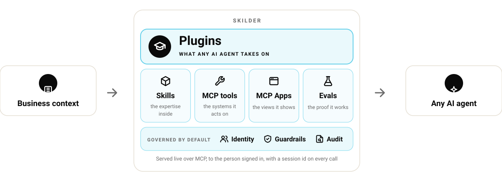
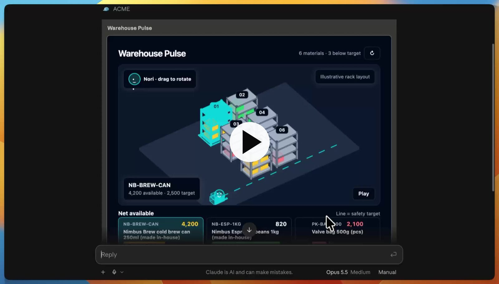

# Skilder plugin

[](https://skills.sh/skilder-ai/plugin)

[Skilder](https://skilder.ai) is where AI builders orchestrate the capabilities their agents use at work. A builder composes plugins from skills, MCP tools and MCP Apps, publishes them to a workspace, and Skilder serves them live to any agent over MCP: the right plugin for the task, under the workspace's permissions and guardrails, with a record of every call.

This plugin is the entry point. It connects the agent to the workspace and teaches it the way Skilder works: start the task, learn the plugin that fits, then act, with a session id on every call.

The plugins, skills, tools and Apps themselves stay in the workspace, versioned and governed there, and are served at the moment of the call. Nothing of that content is bundled here, and this repository is not a catalog of it: it holds one plugin, the entry, and a marketplace of that one plugin so administrators can govern it.

<picture>
  <source media="(prefers-color-scheme: dark)" srcset="assets/platform-dark.svg">
  
</picture>

A team's business context goes in on the left: its processes, vocabulary, documents and systems. Skilder turns it into plugins, each composed of skills, MCP tools, MCP Apps and evals, and governs them by default with identity, guardrails and an audit trail. Any AI agent takes them on from the right. This repository is that right-hand arrow.

## See it

A two-minute tour: an agent connects, takes on a plugin, runs its skills and tools, and opens an MCP App inside the conversation.

<a href="https://youtu.be/3bL_y502_iY">
  
</a>

## Install

Every client can add the plugin directly from this repository. Clients that manage plugins through marketplaces can also add this repository as a marketplace: it lists one plugin, `skilder`, and that is how an administrator allows, installs by default or requires it for a whole team.

| Client | Directly | As a marketplace |
|---|---|---|
| Claude Code | `/plugin` › add this repository | `claude plugin marketplace add skilder-ai/plugin` then `claude plugin install skilder@skilder-ai` |
| claude.ai, Claude Desktop, Cowork | Customize › Plugins › Add, from this repository (the directory listing follows) | Customize › Plugins › Add marketplace, this repository |
| Codex | Plugins › Add, from this repository | `codex plugin marketplace add skilder-ai/plugin`, then install `skilder` |
| ChatGPT | From the plugin directory once listed | |
| GitHub Copilot CLI | `copilot plugin install skilder-ai/plugin` | |
| Gemini CLI | `gemini extensions install https://github.com/skilder-ai/plugin` | |
| Any agent, skills only | `npx skills add skilder-ai/plugin` | |

The first Skilder call opens a browser sign-in on app.skilder.ai. The user signs in, picks one workspace and presses Approve. Nothing is granted before that press.

If a `skilder` or `skilder-ai` server was added to the client by hand before the plugin, remove that entry: the plugin's server points at the same endpoint, and the duplicate costs a second sign-in.

## Plugin, marketplace, workspace

Three words, three different things.

- **The plugin** is the entry. It configures the connection and teaches the agent how Skilder works. It is the same for everyone and changes only when that protocol changes.
- **The marketplace** is the governance handle of the entry. A client's administrator allows or blocks marketplaces and installs their plugins by policy; this repository is a marketplace of one plugin so that handle exists. It is not a catalog of a workspace's content.
- **The workspace** is where the capabilities live: the plugins a team's builders compose from skills, MCP tools and MCP Apps, with versions, permissions, guardrails and a record of every call. A marketplace hands out copies that age on each machine; Skilder serves the published version at the moment of the call, to the person signed in, with the scope their session has learned. That is why none of it is bundled here. In the workspace itself a plugin is called a role, the job an agent takes on; `init_skilder` and `learn` use that word.

## What the plugin does, in full

| | |
|---|---|
| Server | One remote MCP server, `https://app.skilder.ai/mcp`, Streamable HTTP, operated by skilder.ai SA ([privacy](https://www.skilder.ai/en/privacy), [terms](https://www.skilder.ai/en/terms)). |
| Credentials | None in the plugin. OAuth 2.1 in the browser; the token is issued to the MCP client and stored by it. |
| What flows out | The one-sentence task summary the agent writes for `init_skilder`, and the tool calls it makes against the chosen workspace. Both are recorded in that workspace for its admins, under a session. |
| What flows in | The plugins, skills, tool schemas, files and MCP Apps the workspace's own builders published. |
| What stays local | On Claude Code and Cowork only: one small file per project under the plugin's data directory, mode 0600, holding the Skilder session id, when it was issued and the task summary, so a resumed conversation can continue its session. Nothing else is written. |
| Revoke | Personal settings → Connected apps in Skilder. Removing the server from the client stops that client from using the grant. |

## What is inside

| Path | Loaded by | Purpose |
|---|---|---|
| `skills/using-skilder` | every client | The entry protocol: `init_skilder` with a task summary, learn the plugin (role) then the skill, the session id on every call, read vs write, files, MCP Apps, feedback, and what each refusal means. |
| `skills/connect-to-skilder` | every client | Connects a client that has no Skilder server yet: discloses the connection, asks once, adds the entry, hands over to the browser sign-in. Recognises the plugin's own server and never adds a duplicate. |
| `skills/import-skills-to-skilder` | every client | Imports the Agent Skills already on the machine into the workspace, as drafts, for a workspace admin. |
| `skills/get-started-with-skilder` | every client | First steps after connecting: what the workspace holds in plain language and one real first task, or, on a new workspace, an import or a first plugin. The onboarding skill ChatGPT and Codex run after install. |
| `skills/capture-work-in-skilder` | every client | Turns this conversation or a named document into skills, a plugin (role), an App or a new version of existing ones, as the work calls for; suggests tools or a connector; builds only after the user approves a short build summary (workspace admin). |
| `skills/list-or-build-skilder-apps` | every client | Lists the workspace's Apps and opens one, or designs and builds a first App with the user: screen, tools, publish, attach to a skill, each after a go (workspace admin). |
| `skills/review-skilder-activity` | every client | A read-only receipt of what a session did: roles, skills, tools and how each call ended, through the `analytics` tool. |
| `claude/commands/skilder.md` | Claude Code, Cowork | `/skilder <task>`: summarises the task, calls `init_skilder`, reports the suggested role, learns it. |
| `claude/commands/{start,import,capture,activity,app}.md` | Claude Code, Cowork | `/skilder:start`, `/skilder:import`, `/skilder:capture`, `/skilder:activity`, `/skilder:app`: one line each, handing over to the matching skill, so other clients get the same behaviour from the skill alone. |
| `claude/hooks.json` + `claude/scripts/` | Claude Code, Cowork | Two shell hooks: a line of context at session start; the session id remembered per project for a resumed conversation. No network, no permission change. |
| `plugin.json`, `mcp.json` | Codex, Copilot, Cursor, VS Code, Kiro | The Agent Plugins 1.0 manifest and MCP configuration. |
| `.claude-plugin/`, `.mcp.json` | Claude | The Claude plugin manifest, the marketplace and the MCP configuration. |
| `.agents/plugins/marketplace.json` | Codex, ChatGPT desktop | The same one-plugin marketplace in Codex's format, with its install and sign-in policy. |
| `gemini-extension.json` | Gemini CLI | The extension manifest. |

The skills follow the open [Agent Skills](https://agentskills.io) format, and the plugin the [Agent Plugins 1.0](https://agent-plugins.org) standard, with the Claude manifest alongside.

## How a task runs

1. The agent calls `init_skilder` with a one-sentence summary of the task it wrote itself. Skilder answers with the plugin that fits, or candidates, or the catalog, and a session id.
2. The agent learns the plugin (`learn roles/<name>`), then the skill the task needs. With session tracking on, a tool is runnable only once its skill has been learned in that session.
3. The agent runs the skill's tools through `run_read_tool` and `run_write_tool`, its scripts through `execute_script`, and opens the skill's MCP Apps with `open_app` where the client renders cards, with the session id on each call. Skilder applies the workspace's permissions and guardrails and records each call.
4. At the end, `feedback_skill` tells the plugin's builders what worked.

Docs: [docs.skilder.ai](https://docs.skilder.ai) · Issues: [github.com/skilder-ai/plugin/issues](https://github.com/skilder-ai/plugin/issues) · Security: [SECURITY.md](SECURITY.md)

## Develop

```bash
node scripts/check-manifests.mjs   # the manifests agree, and match the tag on a release
node scripts/lint-skills.mjs       # wording that scanners flag
claude plugin validate . --strict  # the Claude manifest, hooks and skills
scripts/package-openai.sh          # dist/skilder-openai-<version>.zip for the OpenAI directory
```

A release is a tag `vX.Y.Z` whose version equals the manifests'. The directories follow tags.

## License

MIT
